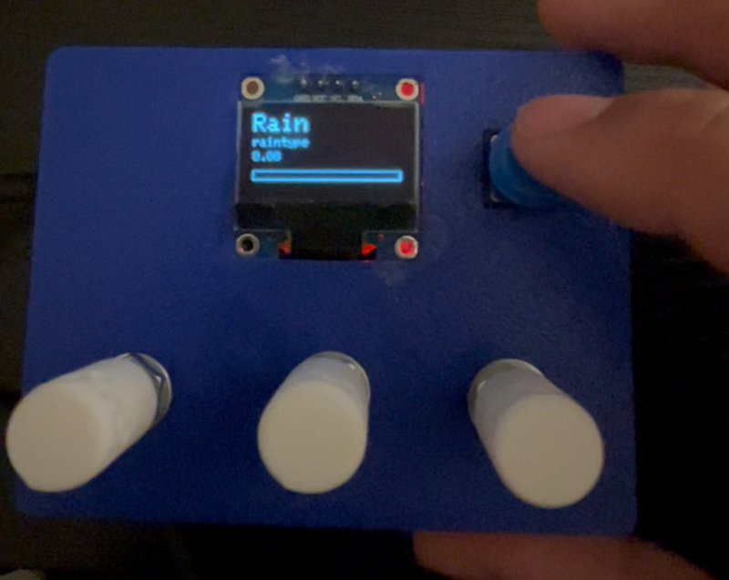

# Ambience Generator

A pocket box that makes ambient sound. Three knobs: Noise + Crackle, Rain, Birds. Powered over USB, fully offline.



Demo video: [media/demo.mp4](media/demo.mp4)

## Hardware

- ESP32-S3 N16R8 (16 MB flash, 8 MB PSRAM)
- UDA1334A I2S DAC with headphone out (BCLK 4, WSEL 5, DIN 6)
- SSD1306 0.96" OLED (SDA 8, SCL 9)
- 3x EC11 encoders (CLK/DT 14/13, 10/11, 15/16), one shared button on GPIO 21
- 3D printed case: `cad/` (tray + lid)

## How it works

- Noise + Crackle is a Max RNBO patch exported to C++
- Rain and Birds are recordings in flash, loaded into PSRAM and played by my own code (RNBO's groove~ made a whine on the ESP32)
- Turn a knob to change a value, press the button to switch parameter. Hold 3 s to restart

## Files

- `firmware/AmbienceGenerator/` – Arduino sketch, RNBO export, samples in `data/`
- `firmware/libraries/AmbienceEngine/` – I2S, encoder, OLED code + RNBO library
- `max/AmbienceGenerator.rnbopat` – the original RNBO patch (all three layers)
- `cad/` – case STL / STEP

## Build

1. Copy `firmware/libraries/AmbienceEngine` into your Arduino libraries folder
2. Board: ESP32S3 Dev Module, Flash 16 MB, PSRAM OPI, Partition Scheme: Custom (uses `partitions.csv`)
3. Upload the sketch
4. Pack `data/` with mklittlefs and flash it at 0x310000:
   ```
   mklittlefs -c data -b 4096 -p 256 -s 0xCF0000 littlefs.bin
   esptool.py write_flash 0x310000 littlefs.bin
   ```
