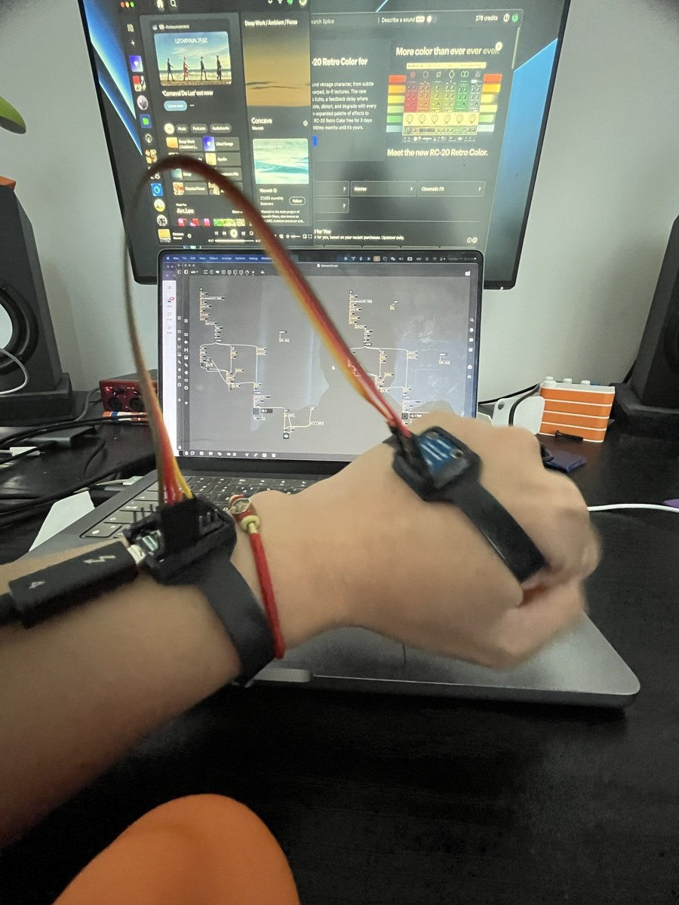

# Sensor Drum

Play conga samples by hitting the air. An accelerometer on the back of each hand streams to Max, which detects the hit and plays a drum sample, louder when you hit harder.

Demo video: [media/demo.mp4](media/demo.mp4)

## Hardware (x2, one per drum)

- ESP32-C3 Super Mini
- Adafruit MMA8451 accelerometer
- Wiring: 3V3 → VIN, GND → GND, GPIO3 → SDA, GPIO4 → SCL

## Files

- `sensor_drum/sensor_drum.ino` – reads the MMA8451 at 800 Hz (±8 g) and prints `x y z` lines over USB serial
- `SensorDrum.maxpat` – two identical channels, one per sensor

## How the patch detects a hit

Only the z axis is used. It's divided by 1024 to get g, and gravity is removed so the hand at rest sits around 0.

1. Raise the hand: z drops below -0.3 g, which opens a 350 ms window
2. Hit: z goes above 0.6 g inside that window → trigger
3. Velocity is the peak of the next 8 samples (~10 ms), mapped from 0.6–3 g to 0.1–1
4. 100 ms lockout so one hit doesn't trigger twice

## Setup

1. Arduino IDE: board "ESP32C3 Dev Module", Tools → USB CDC On Boot: Enabled. Libraries: Adafruit MMA8451, Adafruit Unified Sensor, Adafruit BusIO
2. Flash both boards
3. In Max, change the port names in the two `serial` objects (`usbmodem1101`, `usbmodem2101`) to match yours. Click `print` to list ports
4. Click `replace` on each `buffer~` to load a drum sample
5. Turn on the toggles to start reading

Part of [weird-hardware](../). MPATE-UE 1801 Advanced Computer Music, NYU, Fall 2026.
